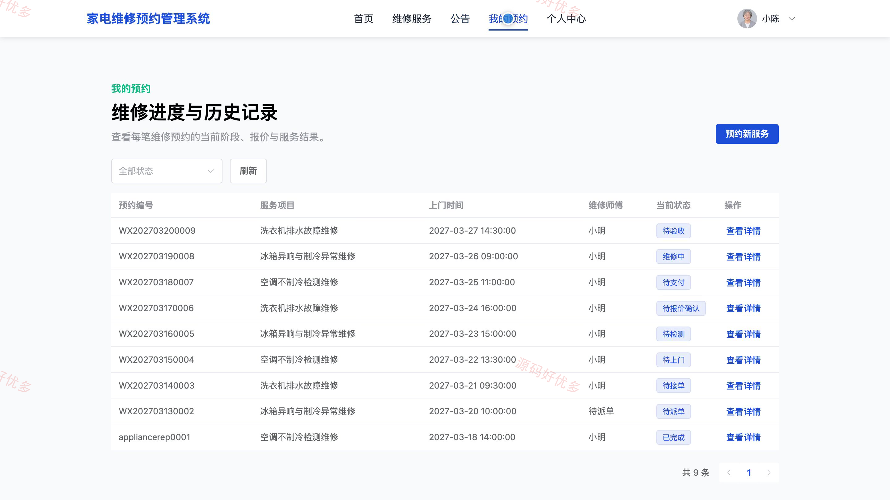
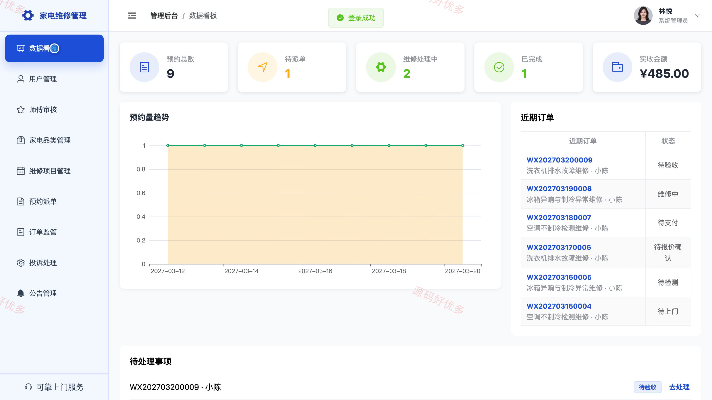
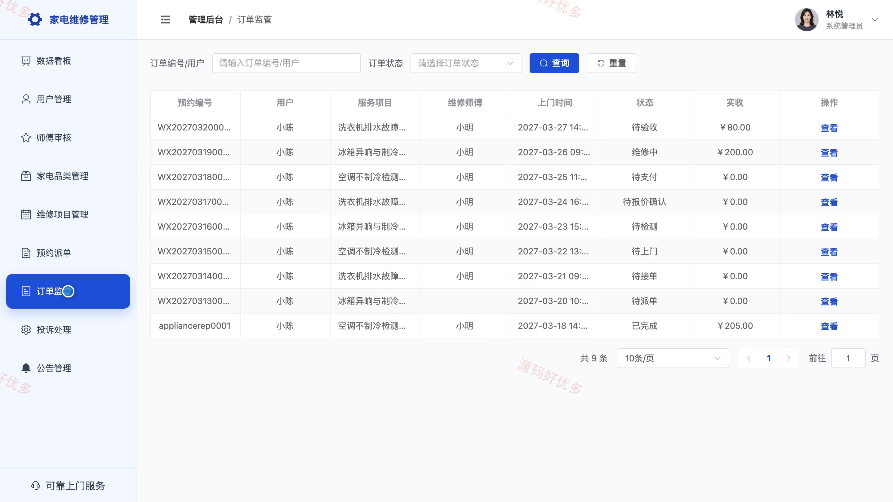

# bs133A
bs133A家电维修预约管理系统源码 Java SpringBoot3 Vue3 前后分离
## 源码问题查看主页咨询

### 一、关键词
家电维修预约、上门维修、维修派单、家电售后服务、维修工单

### 二、作品包含
源码+数据库+万字设计文档+PPT+全套环境和工具资源+本地部署教程

### 三、项目技术
前端技术： Html、Css、Js、Vue3.4、Element-Plus
后端技术：Java、SpringBoot3.2.0、MyBatis-Plus

### 四、运行环境要求
开发工具：IDEA/eclipse + VSCODE

数据库：MySQL5.7+（共7张表）

数据库管理工具：Navicat10以上版本

环境配置软件： JDK17 + Maven3.6

前端Nodejs：16+

浏览器：谷歌浏览器

### 五、项目介绍
项目编号：bs133A

面向家电上门维修业务，用户可浏览服务、提交预约、确认报价、模拟支付并评价或投诉；维修师傅处理派单、检测报价和完工；管理员维护服务项目并监管订单。

角色：用户、维修师傅、管理员

用户功能：家电服务浏览、维修预约提交、报价确认、模拟支付、维修进度查询、完工确认、评价与投诉、个人资料维护。

维修师傅功能：工作台与服务统计、派单接收、上门安排、故障检测与报价、维修进度更新、配件使用记录、完工提交、服务记录查询。

管理员功能：用户管理、维修师傅审核、家电品类管理、维修项目管理、预约派单、订单监管、投诉处理、数据统计。

### 六、运行截图

